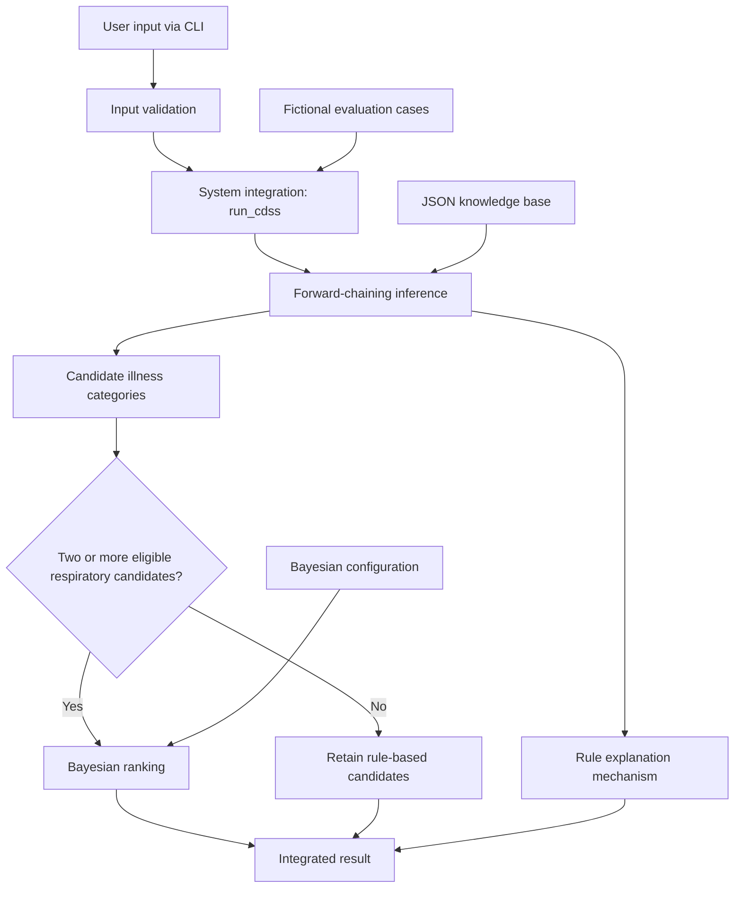

# Clinical Decision Support System (CDSS)

## AINL3001 - Knowledge-Driven Artificial Intelligence

**TU Dublin | BSc Data Science and Artificial Intelligence**

### Group A

| Name | Student Number | GitHub Username |
| --- | --- | --- |
| Hamza Zeeshan | C24333116 | Developere19 |
| Mohammed Younis | C24372973 | Mohammedyounis18 |

## 1. Project Overview

This project implements an educational Clinical Decision Support System (CDSS) using knowledge-driven artificial intelligence techniques in Python.

The system accepts symptoms through a command-line interface, applies rule-based forward-chaining inference to identify possible illness categories, and uses Bayesian reasoning to rank overlapping respiratory candidates.

The system also provides human-readable explanations showing how conclusions were derived.

This project is intended for educational purposes only. It does not provide medical diagnoses, prescribe medication or replace professional medical advice.

## 2. Project Objectives

- Develop a structured symptom knowledge base.
- Implement multi-stage forward-chaining inference.
- Distinguish between present, absent and unknown symptoms.
- Integrate rule-based and Bayesian reasoning.
- Provide transparent explanations of inferred conclusions.
- Evaluate system behaviour using fictional cases and automated tests.

## 3. System Scope

| Component | Quantity |
| --- | ---: |
| Illness categories | 6 |
| Symptoms | 20 |
| Intermediate concepts | 13 |
| IF-THEN rules | 35 |
| Bayesian respiratory categories | 3 |
| Fictional evaluation cases | 8 |
| Automated tests | 17 |

### Supported Illness Categories

- Influenza-like illness
- COVID-like illness
- Common cold-like illness
- Allergy-like illness
- Strep-throat-like illness
- Gastroenteritis-like illness

## 4. Repository Structure

```text
clinical-decision-support-system/
├── .gitignore
├── .vscode/
│   └── settings.json
├── data/
│   ├── knowledge_base.json
│   └── bayesian_config.json
├── docs/
│   └── report.md
├── proposal/
│   └── proposal.md
├── src/
│   └── cdss/
│       ├── knowledge_base.py
│       ├── inference.py
│       ├── bayes.py
│       ├── integration.py
│       ├── explanation.py
│       ├── cli.py
│       └── evaluation.py
├── tests/
│   └── test_cdss.py
├── requirements.txt
└── README.md
```

### Component Responsibilities

| File | Purpose |
| --- | --- |
| `knowledge_base.json` | Stores symptoms, intermediate concepts, illness categories and inference rules. |
| `bayesian_config.json` | Stores prior probabilities and illustrative symptom likelihoods. |
| `knowledge_base.py` | Loads and validates the knowledge base. |
| `inference.py` | Implements the forward-chaining inference engine. |
| `bayes.py` | Implements Bayesian candidate ranking. |
| `integration.py` | Integrates the reasoning components. |
| `explanation.py` | Generates human-readable rule explanations. |
| `cli.py` | Handles user input and displays results. |
| `evaluation.py` | Evaluates expected and actual illness categories using fictional cases. |
| `test_cdss.py` | Contains automated tests for individual components and system integration. |

## 5. System Architecture



The rule-based component identifies possible illness categories before Bayesian reasoning is applied.

Bayesian ranking is conditional and is only performed when at least two eligible respiratory candidates are identified.

The explanation mechanism converts fired rule identifiers into readable explanations of rule-based conclusions.

## 6. Installation

### Requirements

- Python 3 (tested with Python 3.13.7)
- Git
- Pytest (specified in `requirements.txt`)

### Clone the Repository

```bash
git clone https://github.com/Developere19/clinical-decision-support-system.git
cd clinical-decision-support-system
```

### Install Dependencies

```bash
python -m pip install -r requirements.txt
```

The core reasoning system uses Python's standard library. Pytest is required for automated testing.

## 7. Running the System

From the repository root, run:

```bash
python src/cdss/cli.py
```

The command-line interface allows users to:

1. View available symptoms.
2. Enter present symptoms.
3. Enter explicitly absent symptoms.
4. Receive inferred illness categories.
5. View Bayesian rankings where applicable.
6. View explanations of fired rules.

### Example Input

```text
Present symptoms:
fever, fatigue, cough, sore throat, loss of smell, runny nose, sneezing

Absent symptoms (symptoms the user confirms they are not experiencing):
```

Leave the absent symptoms input blank for this fictional example.

### Expected Candidate Categories

```text
common_cold_like
covid_like
influenza_like
```

### Expected Bayesian Ranking

```text
1. covid_like        0.6410
2. common_cold_like  0.2564
3. influenza_like    0.1026
```

The system also displays the reasoning explanations associated with the inferred categories. The scores are relative rankings under illustrative modelling assumptions, not clinical diagnostic probabilities.

## 8. Evaluation and Automated Testing

### Validate the Knowledge Base

```bash
python src/cdss/knowledge_base.py
```

### Run the Evaluation Framework

```bash
python src/cdss/evaluation.py
```

### Run Automated Tests

```bash
python -m pytest -v
```

### Results Summary

| Verification | Total | Passed | Failed |
| --- | ---: | ---: | ---: |
| Fictional evaluation cases | 8 | 8 | 0 |
| Automated tests | 17 | 17 | 0 |

The evaluation framework compares expected and actual illness categories. The automated tests additionally verify Bayesian ranking, negative evidence, explanation generation and integration between reasoning components.

These results demonstrate agreement with predefined prototype expectations, not medical diagnostic accuracy.

## 9. Technical Report

The [Technical Report](docs/report.md) provides detailed information about problem formulation, knowledge representation, forward chaining, Bayesian reasoning, worked calculations, evaluation results, limitations, future improvements and references.

## 10. Team Contributions

| **Team Member** | **Responsibilities and Contributions** |
| --- | --- |
| Hamza Zeeshan | GitHub management, knowledge-base development, IF-THEN rules, forward chaining, knowledge-base validation, system integration, Bayesian configuration and integration, CLI integration and end-to-end testing. |
| Mohammed Younis | Bayesian ranking module, command-line interface, explanation mechanism, evaluation framework and automated testing. |

Both team members contributed to system design, debugging, documentation, evaluation and testing.

## 11. AI Assistance Acknowledgement

Generative AI tools were used to support brainstorming, code development, debugging, testing and documentation.

The team is responsible for reviewing the generated material, understanding the implemented techniques and verifying system behaviour.

---

**Developed for AINL3001 Knowledge-Driven Artificial Intelligence at TU Dublin.**
