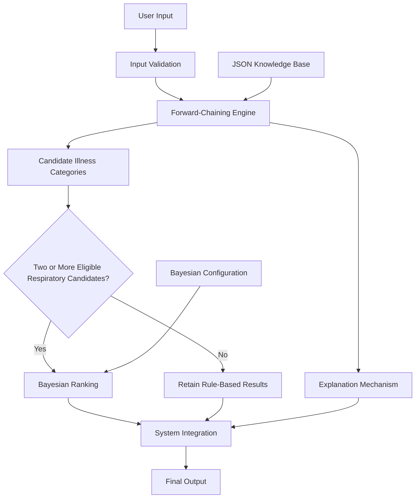

# Clinical Decision Support System (CDSS)

## AINL3001 - Knowledge-Driven Artificial Intelligence

**TU Dublin | BSc Data Science and Artificial Intelligence**

### Group A

| Name | Student Number | GitHub Username |
| --- | --- | --- |
| Hamza Zeeshan | C24333116 | Developere19 |
| Mohammed Younis | C24372973 | Mohammedyounis18 |

## 1. Project Overview

This project implements an educational Clinical Decision Support System (CDSS) using knowledge-driven artificial intelligence techniques in Python.

The system accepts symptoms through a command-line interface, applies rule-based forward-chaining inference to identify possible illness categories, and uses Bayesian reasoning to rank overlapping respiratory candidates.

The system also provides human-readable explanations showing how conclusions were derived.

This project is intended for educational purposes only. It does not provide medical diagnoses, prescribe medication or replace professional medical advice.

## 2. Project Objectives

- Develop a structured symptom knowledge base.
- Implement multi-stage forward-chaining inference.
- Distinguish between present, absent and unknown symptoms.
- Integrate rule-based and Bayesian reasoning.
- Provide transparent explanations of inferred conclusions.
- Evaluate system behaviour using fictional cases and automated tests.

## 3. System Scope

| Component | Quantity |
| --- | ---: |
| Illness categories | 6 |
| Symptoms | 20 |
| Intermediate concepts | 13 |
| IF-THEN rules | 35 |
| Bayesian respiratory categories | 3 |
| Fictional evaluation cases | 8 |
| Automated tests | 17 |

### Supported Illness Categories

- Influenza-like illness
- COVID-like illness
- Common cold-like illness
- Allergy-like illness
- Strep-throat-like illness
- Gastroenteritis-like illness

## 4. Repository Structure

```text
clinical-decision-support-system/
│
├── data/
│   ├── knowledge_base.json
│   └── bayesian_config.json
│
├── src/
│   └── cdss/
│       ├── knowledge_base.py
│       ├── inference.py
│       ├── bayes.py
│       ├── integration.py
│       ├── explanation.py
│       ├── cli.py
│       └── evaluation.py
│
├── tests/
│   └── test_cdss.py
│
└── README.md
```

### Component Responsibilities

| File | Purpose |
| --- | --- |
| `knowledge_base.json` | Stores symptoms, intermediate concepts, illness categories and inference rules. |
| `bayesian_config.json` | Stores prior probabilities and illustrative symptom likelihoods. |
| `knowledge_base.py` | Loads and validates the knowledge base. |
| `inference.py` | Implements the forward-chaining inference engine. |
| `bayes.py` | Implements Bayesian candidate ranking. |
| `integration.py` | Integrates the reasoning components. |
| `explanation.py` | Generates human-readable rule explanations. |
| `cli.py` | Handles user input and displays results. |
| `evaluation.py` | Evaluates expected and actual illness categories using fictional cases. |
| `test_cdss.py` | Contains automated tests for individual components and system integration. |

## 5. System Architecture



The rule-based component identifies possible illness categories before Bayesian reasoning is applied.

Bayesian ranking is conditional and is only performed when at least two eligible respiratory candidates are identified.

## 6. Knowledge Representation

The knowledge base is stored in JSON, separating domain knowledge from the reasoning engine.

It contains:

- Symptoms
- Intermediate concepts
- Illness categories
- IF-THEN rules
- Explicitly absent symptom conditions

Intermediate concepts allow the system to perform multi-stage reasoning rather than relying exclusively on direct symptom matching.

### Example Rule

```json
{
    "id": "R1",
    "conditions": ["fever", "body_aches"],
    "conclusion": "systemic_symptoms"
}
```

### Multi-Stage Reasoning Example

```text
IF fever AND body aches
THEN systemic symptoms

IF cough AND sore throat
THEN respiratory symptoms

IF systemic symptoms AND respiratory symptoms
THEN influenza-like illness
```

The conclusions produced by earlier rules become available as facts for subsequent rules.

### Symptom States

| State | Meaning |
| --- | --- |
| Present | The user explicitly reports experiencing the symptom. |
| Absent | The user explicitly reports not experiencing the symptom. |
| Unknown | The user does not provide information about the symptom. |

Unknown symptoms are not automatically treated as absent.

This distinction prevents rules requiring negative evidence from firing solely because a symptom was not reported.

### Knowledge Base Validation

The validation mechanism checks for:

- Duplicate rule identifiers.
- Unknown rule conditions.
- Invalid absent symptom references.
- Unknown rule conclusions.

This helps maintain consistency between the rules and declared knowledge base entities.

## 7. Forward-Chaining Inference

Forward chaining is a data-driven reasoning technique that begins with known facts and applies rules to derive additional conclusions.

The inference engine follows this process:

1. Initialise the knowledge state using reported present symptoms.
2. Retain explicitly absent symptoms separately.
3. Examine the available IF-THEN rules.
4. Check whether positive and negative conditions are satisfied.
5. Add newly derived conclusions to the knowledge state.
6. Record the identifiers of rules that derive new facts.
7. Repeat until no additional facts can be derived.

The reasoning process terminates at a fixed point.

### AIMA-Inspired Problem Formulation

| Element | Description |
| --- | --- |
| Initial state | Symptoms initially reported by the user. |
| State | Known and derived facts, with explicit absence retained separately. |
| Actions | Application of rules whose conditions are satisfied. |
| Transition model | Addition of a newly inferred fact to the knowledge state. |
| Termination condition | No applicable rule can produce an additional fact. |
| Output | Candidate illness categories and reasoning trace. |

The system uses an AIMA-inspired representation of states, actions and transitions. It does not implement a conventional path-finding search algorithm.

## 8. Bayesian Reasoning

The Bayesian component addresses uncertainty when overlapping symptoms produce multiple respiratory candidates.

Bayesian ranking supports:

- Influenza-like illness
- COVID-like illness
- Common cold-like illness

The Bayesian module does not independently generate illness categories. It ranks eligible candidates already identified by forward chaining.

### 8.1 Prior Probabilities

Equal prior probabilities are assigned to the three respiratory categories.

| Category | Prior Probability |
| --- | ---: |
| Influenza-like illness | 0.333333 |
| COVID-like illness | 0.333333 |
| Common cold-like illness | 0.333333 |

Equal priors are used as a neutral educational modelling assumption because the system does not contain population prevalence data.

### 8.2 Symptom Likelihoods

An illustrative three-level likelihood scale is used.

| Value | Interpretation |
| --- | --- |
| 0.8 | Strong symptom association |
| 0.5 | Moderate symptom association |
| 0.2 | Weak symptom association |

The configured values are:

| Symptom | Influenza-like | COVID-like | Common cold-like |
| --- | ---: | ---: | ---: |
| Fever | 0.8 | 0.8 | 0.2 |
| Fatigue | 0.8 | 0.8 | 0.2 |
| Cough | 0.8 | 0.8 | 0.5 |
| Sore throat | 0.5 | 0.5 | 0.8 |
| Loss of smell | 0.2 | 0.5 | 0.5 |
| Runny nose | 0.2 | 0.5 | 0.8 |
| Sneezing | 0.2 | 0.2 | 0.8 |
| Blocked nose | 0.2 | 0.5 | 0.8 |
| Headache | 0.8 | 0.5 | 0.5 |
| Body aches | 0.8 | 0.5 | 0.5 |

These values are illustrative modelling parameters, not statistically estimated medical probabilities.

The scale provides a transparent mechanism for demonstrating how different evidence strengths affect candidate rankings.

### 8.3 Bayesian Calculation

The implementation follows a Naive Bayes-style scoring approach.

For each eligible illness category:

```text
Score =
    Prior
    × Product of present symptom likelihoods
    × Product of absent symptom complementary likelihoods
```

Mathematically:

$$
S(C) = P(C)
\prod_{s \in E^+} P(s \mid C)
\prod_{s \in E^-} (1-P(s \mid C))
$$

Where:

- C represents an eligible illness category.
- P(C) represents its prior probability.
- E+ represents reported present symptoms.
- E- represents explicitly absent symptoms.

Only symptoms with configured likelihoods contribute to the calculation.

The resulting scores are normalised across eligible candidates:

$$
R(C_i) =
\frac{S(C_i)}
{\sum_j S(C_j)}
$$

Candidates are then sorted in descending order of their relative scores.

### 8.4 Handling Symptom Evidence

| Symptom State | Bayesian Treatment |
| --- | --- |
| Present | Multiply by the configured likelihood. |
| Absent | Multiply by one minus the configured likelihood. |
| Unknown | Exclude from the calculation. |
| No configured likelihood | Exclude from the calculation. |

For example, if the likelihood of a symptom is 0.8:

```text
Present symptom: multiply by 0.8
Absent symptom:  multiply by 0.2
Unknown symptom: no contribution
```

### 8.5 Worked Bayesian Example

Consider the following reported symptoms:

```text
fever, fatigue, cough, sore_throat,
loss_of_smell, runny_nose, sneezing
```

Forward chaining identifies:

- Influenza-like illness
- COVID-like illness
- Common cold-like illness

The Bayesian scores are calculated using the configured likelihoods.

#### Influenza-like Illness

```text
Score = 0.333333 × 0.8 × 0.8 × 0.8
                 × 0.5 × 0.2 × 0.2 × 0.2

Score ≈ 0.00068267
```

#### COVID-like Illness

```text
Score = 0.333333 × 0.8 × 0.8 × 0.8
                 × 0.5 × 0.5 × 0.5 × 0.2

Score ≈ 0.00426666
```

#### Common Cold-like Illness

```text
Score = 0.333333 × 0.2 × 0.2 × 0.5
                 × 0.8 × 0.5 × 0.8 × 0.8

Score ≈ 0.00170667
```

After normalisation:

| Rank | Candidate | Relative Score |
| --- | --- | ---: |
| 1 | COVID-like illness | 0.6410 |
| 2 | Common cold-like illness | 0.2564 |
| 3 | Influenza-like illness | 0.1026 |

This example demonstrates how Bayesian reasoning ranks candidates that the rule-based system alone cannot distinguish by score.

The relative scores are not clinically validated diagnostic probabilities.

## 9. Explanation Mechanism

The explanation mechanism improves transparency by converting fired rule identifiers into readable explanations.

Each explanation identifies:

- The rule that fired.
- The conditions that were satisfied.
- The conclusion that was inferred.

Example:

```text
R2 fired because cough and sore_throat
were present or derived, so respiratory_symptoms
was inferred.
```

This allows users to understand how rule-based conclusions were reached.

## 10. Installation

### Requirements

- Python 3
- Git
- Pytest

### Clone the Repository

```bash
git clone https://github.com/Developere19/clinical-decision-support-system.git
```

Navigate to the project directory:

```bash
cd clinical-decision-support-system
```

### Install Testing Dependency

```bash
python -m pip install pytest
```

The core reasoning system uses Python's standard library.

## 11. Running the System

From the repository root, run:

```bash
python src/cdss/cli.py
```

The command-line interface allows users to:

1. View available symptoms.
2. Enter present symptoms.
3. Enter explicitly absent symptoms.
4. Receive inferred illness categories.
5. View Bayesian rankings where applicable.
6. View explanations of fired rules.

### Example Input

```text
Present symptoms:
fever, fatigue, cough, sore throat,
loss of smell, runny nose, sneezing

Absent symptoms:
```

### Expected Candidate Categories

```text
common_cold_like
covid_like
influenza_like
```

### Expected Bayesian Ranking

```text
1. covid_like        0.6410
2. common_cold_like  0.2564
3. influenza_like    0.1026
```

The system also displays the reasoning explanations associated with the inferred categories.

## 12. Evaluation

The system is evaluated using fictional symptom scenarios covering the supported illness categories and reasoning behaviours.

Run the evaluation framework:

```bash
python src/cdss/evaluation.py
```

### Evaluation Scenarios

| Scenario | Expected Behaviour |
| --- | --- |
| Influenza-like symptoms | Infer influenza-like illness. |
| Common cold-like symptoms | Infer common cold-like illness. |
| COVID-like symptoms | Infer COVID-like illness. |
| Allergy-like symptoms | Infer allergy-like illness. |
| Strep-throat-like symptoms | Infer strep-throat-like illness with appropriate negative evidence. |
| Gastrointestinal symptoms | Infer gastroenteritis-like illness. |
| Overlapping respiratory symptoms | Identify multiple respiratory candidates. |
| Insufficient information | Return no illness candidates. |

### Evaluation Results

| Metric | Result |
| --- | ---: |
| Evaluation cases | 8 |
| Passed | 8 |
| Failed | 0 |
| Pass rate | 100% |

These results measure agreement between expected and actual prototype behaviour, not medical diagnostic accuracy.

## 13. Automated Testing

Automated tests are implemented using Pytest.

Run the complete test suite:

```bash
python -m pytest -v
```

### Testing Coverage

The tests verify:

- Knowledge base validation.
- Inference across all six illness categories.
- Multi-stage forward chaining.
- Explicitly absent symptom handling.
- Unknown symptom handling.
- Present symptom handling.
- Overlapping illness candidates.
- Insufficient information behaviour.
- Explanation generation.
- Bayesian ranking of three respiratory candidates.
- Bayesian ranking of two respiratory candidates.
- Bayesian handling of explicitly absent evidence.
- Bayesian ranking being skipped for a single candidate.
- Integration between reasoning components.

### Automated Test Results

| Metric | Result |
| --- | ---: |
| Total tests | 17 |
| Passed | 17 |
| Failed | 0 |
| Pass rate | 100% |

The automated tests complement the fictional evaluation scenarios by verifying individual reasoning behaviours and integration.

## 14. Assumptions and Limitations

The system is an educational prototype and has several limitations.

### Simplified Knowledge Base

The knowledge base contains a limited number of symptoms, intermediate concepts and illness categories.

It does not represent the full complexity of medical knowledge.

### Illustrative Bayesian Parameters

Prior probabilities and symptom likelihoods are educational modelling assumptions rather than estimates obtained from clinical datasets.

The relative scores should not be interpreted as diagnostic probabilities.

### Conditional Independence

The Bayesian implementation assumes symptoms are conditionally independent given an illness category.

In reality, symptoms may be correlated.

### Limited Candidate Generation

Bayesian reasoning only ranks eligible respiratory candidates already identified by forward chaining.

An illness category that is not inferred by the rule-based system cannot subsequently be introduced by Bayesian ranking.

### Limited Evaluation

The system is evaluated using fictional scenarios and automated software tests rather than real patient records.

Passing all tests does not establish clinical validity, safety or diagnostic accuracy.

## 15. Future Improvements

Potential extensions include:

- Expanding the knowledge base.
- Supporting additional illness categories.
- Incorporating clinically validated probability estimates.
- Improving uncertainty representation.
- Investigating Bayesian networks to represent symptom dependencies.
- Developing a graphical user interface.
- Expanding evaluation datasets and scenarios.
- Providing more detailed explanations of probabilistic rankings.

## 16. Team Contributions

### Hamza Zeeshan

- GitHub repository setup and management.
- Knowledge base development.
- IF-THEN rule representation.
- Knowledge base validation.
- Forward-chaining inference engine.
- Present, absent and unknown symptom reasoning.
- System integration.
- Bayesian configuration and integration.
- Integration of Bayesian output into the CLI.
- Refinement and expansion of automated tests.
- End-to-end system testing and debugging.

### Mohammed Younis

- Bayesian ranking module.
- Command-line interface.
- Explanation mechanism.
- Evaluation framework.
- Initial automated Pytest suite.
- Component testing and debugging.

### Shared Responsibilities

- System design.
- Reasoning approach discussions.
- Evaluation planning.
- Integration testing.
- Project documentation.
- Final presentation and demonstration.

## 17. AI Assistance Acknowledgement

Generative AI tools were used to support brainstorming, code development, debugging, testing and documentation.

The team is responsible for reviewing the generated material, understanding the implemented techniques and verifying system behaviour.

## 18. Academic and Ethical Considerations

This project demonstrates knowledge representation, forward-chaining inference and probabilistic reasoning within an educational context.

It is not a clinically validated medical system.

No real patient records are required for its fictional evaluation scenarios.

The system must not be used to make real-world medical decisions.

---

**Developed for AINL3001 Knowledge-Driven Artificial Intelligence at TU Dublin.**
